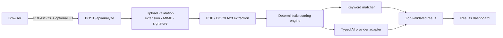

# CVision AI

Portfolio MVP untuk menilai kesiapan CV terhadap ATS secara transparan. Pengguna mengunggah satu CV PDF/DOCX, dapat menambahkan deskripsi lowongan, lalu menerima skor deterministik, bukti perhitungan, keyword gap, dan rekomendasi prioritas.

> Skor adalah estimasi kualitas teks CV, bukan skor resmi dari sistem ATS atau keputusan rekrutmen. CVision tidak menilai foto, usia, gender, agama, atau atribut sensitif lainnya.

## Fitur

- Upload satu PDF atau DOCX, maksimum 5 MB.
- Validasi extension, MIME type, dan file signature sebelum ekstraksi.
- Ekstraksi teks PDF dan DOCX, dengan pesan jelas untuk PDF scan/teks kosong.
- Review umum tanpa lowongan, atau job-match dengan pembanding kata kunci.
- Skor 0–100 yang deterministik dan dapat dijelaskan.
- Breakdown struktur, keyword, dampak pengalaman, dan skill.
- Rekomendasi berurutan tanpa menambahkan pengalaman atau klaim fiktif.
- Local mock untuk development dan adapter OpenAI Responses API opsional untuk production; kredensial tidak pernah masuk ke client.
- Tidak menyimpan atau me-log CV. Response API bersifat `no-store`.
- Rate-limit in-memory sebagai adapter point untuk Redis/Upstash di deployment multi-instance.

## Rumus skor

Saat deskripsi pekerjaan tersedia:

| Kategori | Bobot |
| --- | ---: |
| Struktur & keterbacaan | 25% |
| Kecocokan kata kunci | 30% |
| Pengalaman & dampak | 25% |
| Skills & relevansi | 20% |

Tanpa deskripsi pekerjaan, aplikasi memakai **general-review mode** (struktur 35%, pengalaman 35%, skills 30%). Aplikasi tidak mengklaim melakukan job matching saat tidak ada lowongan target.

## Arsitektur



Source-code boundary:

- `components/` — UI client dan state upload.
- `app/api/analyze/route.ts` — route server, input limits, rate limit, error handling.
- `lib/upload-validation.ts` — validasi file.
- `lib/document-extraction.ts` — parser PDF/DOCX dan guard scanned/empty file.
- `lib/analysis.ts` — scoring serta keyword evidence, independen dari LLM.
- `lib/llm/provider.ts` — interface provider typed dan local mock.
- `lib/schemas.ts` — schema Zod untuk hasil dan output adapter.

## Menjalankan lokal

```bash
npm install
copy .env.example .env.local
npm run dev
```

Buka `http://localhost:3000`, pilih CV sintetis/pribadi yang aman, dan tekan **Analisis CV saya**. Untuk local adapter yang deterministik, set `LLM_PROVIDER=mock` seperti `.env.example`.

## Environment variable

| Variabel | Nilai contoh | Kegunaan |
| --- | --- | --- |
| `LLM_PROVIDER` | `mock` atau `openai` | Memilih adapter lokal atau OpenAI yang hanya berjalan di server. |
| `OPENAI_API_KEY` | `sk-...` | Wajib saat `LLM_PROVIDER=openai`; jangan gunakan prefix `NEXT_PUBLIC_`. |
| `OPENAI_MODEL` | `gpt-4o-mini` | Opsional; model yang mendukung Structured Outputs. |

Tidak ada database pada MVP ini; file dan isi CV tidak dipersist.

## Quality checks

```bash
npm run typecheck
npm run lint
npm test
npx playwright install chromium
npm run test:e2e
npm run build
```

Unit/integration suite mencakup pembobotan skor, mode tanpa job description, keyword matching, invalid/oversized upload, signature mismatch, empty extraction, PDF/DOCX extraction, output AI yang invalid, provider errors, prompt-injection-like content, dan privacy header. Playwright mencakup empty state, invalid file, rendering hasil, serta API failure/retry.

Hasil validasi lokal terbaru ada di [docs/test-report.md](docs/test-report.md).

## Screenshot / demo GIF

Jalankan `npm run dev`, pakai CV sintetis, kemudian rekam alur upload → hasil dashboard melalui browser recorder. Jangan gunakan CV asli atau informasi pribadi di screenshot publik.

## Limitasi & hardening berikutnya

- PDF berbasis gambar memerlukan OCR; saat ini pengguna diminta memakai PDF yang teksnya bisa diseleksi atau DOCX.
- Keyword matching bersifat heuristik, bukan parser lowongan penuh.
- Local mock bukan provider LLM sungguhan. Untuk AI produksi, set `LLM_PROVIDER=openai` beserta `OPENAI_API_KEY`; adapter memakai Responses API, Structured Outputs, timeout 12 detik, `store: false`, dan schema `aiSuggestionsSchema`.
- Ganti rate limit in-memory dengan Redis/Upstash sebelum deployment horizontal.
